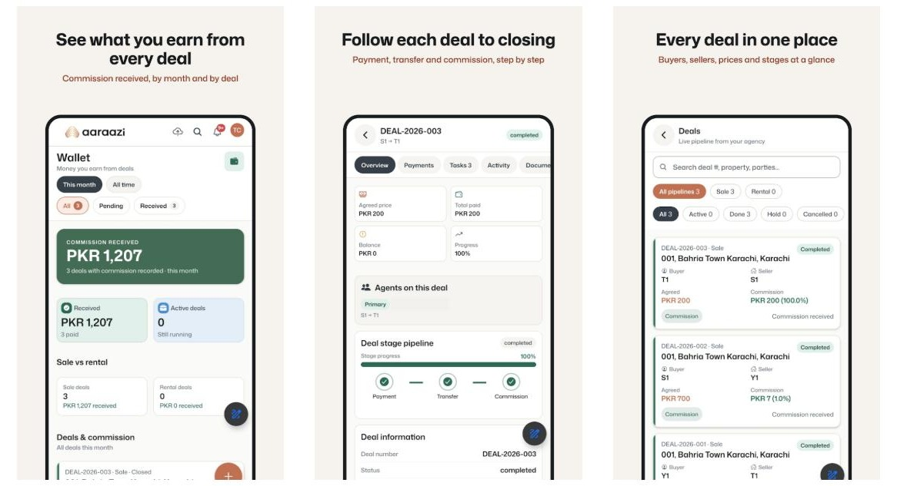
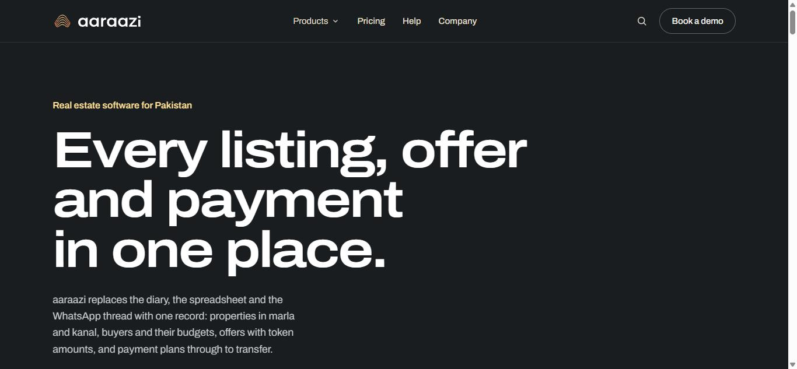
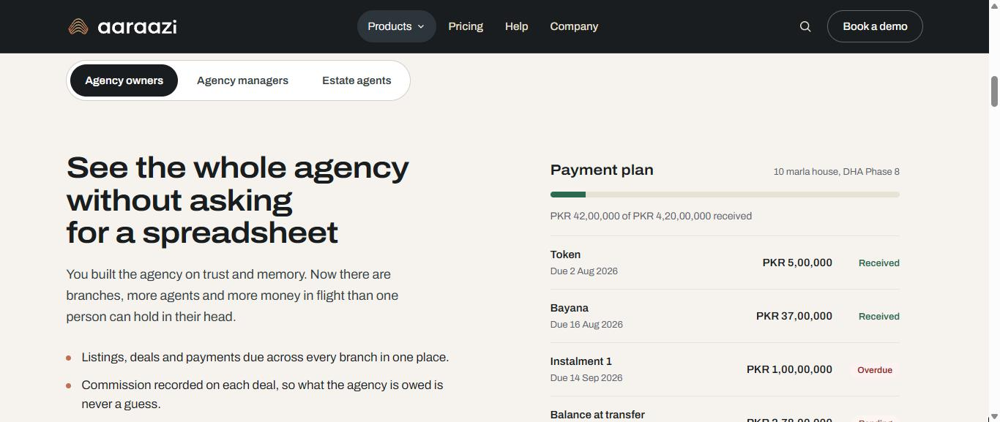
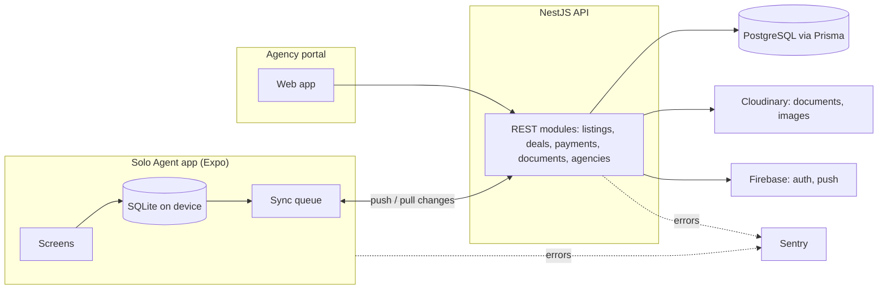

# Aaraazi Core: Real-Estate CRM for Pakistan

**Case study.** The source code belongs to Aaraazi and is private. This repository explains the product, its architecture and my part in building it.

**Live:** [aaraazi.com](https://aaraazi.com) · [Google Play](https://play.google.com/store/apps/details?id=com.aaraazi)
**My role:** Primary developer in a small product team (product owner, dev lead, QA). I built the Agency module (backend and frontend), the full mobile app and the documents module.
**Timeline:** September 2025 to present

## The problem

Most real-estate agents in Pakistan run their business from a diary, a spreadsheet and WhatsApp. Listings in marla and kanal, buyers and their budgets, token money, instalments and commission all live in different places. Agents also work on sites and in markets with weak mobile signal, so a cloud-only app is not enough.

## What I built

Aaraazi Core has two products on one backend:

- **Solo Agent app (Android, React Native/Expo).** Listings, buyers, deals, a deal pipeline from offer to transfer, payment plans, documents and a commission wallet. It works fully offline and syncs when the connection returns.
- **Agency module (web).** For larger agencies with branches and many agents: one view of listings, deals and payments due across every branch, with commission recorded on each deal.

| Website | Agency payment plans |
|---|---|
|  |  |

## Architecture

## Engineering decisions

- **Offline first.** The app writes to SQLite on the device first, so every screen works without signal. Changes go into a queue and sync with the server when the connection returns.
- **One backend, two products.** The solo app and the agency module share the same NestJS modules and data model, with access scoped by agency, branch and role.
- **Money modelled the local way.** Deals follow the real Pakistani flow: token, bayana, instalments and balance at transfer, with commission tracked per deal and per agent.
- **Documents as a module.** Agreements and deal documents are generated, stored and attached to each deal, so the full history of a property sale is in one place.
- **Production visibility.** Sentry on both the app and the API, so crashes and failed syncs are seen and fixed quickly.

## Stack

React Native, Expo, SQLite, TypeScript · NestJS, Prisma, PostgreSQL · Firebase, Cloudinary, Sentry · Google Play release

---

Aliyan Siddiqui · [Portfolio](https://portfolio-aliyan-siddiqui.netlify.app) · [LinkedIn](https://www.linkedin.com/in/aliyan-siddiqui555/)
